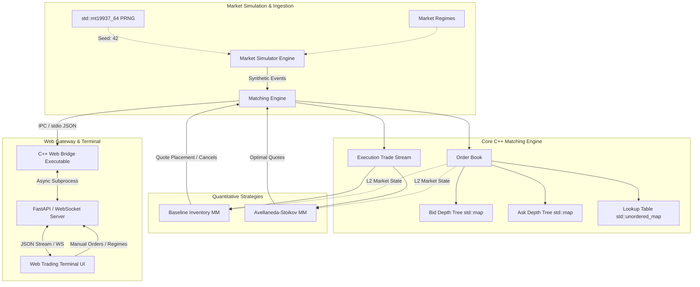

# Ultra-Low Latency Limit Order Book & Quantitative Market Making Engine

[](https://en.cppreference.com/w/cpp/14)
[](tests/)
[](CMakeLists.txt)
[](web/)
[](LICENSE)

A high-performance, deterministic C++ Limit Order Book (LOB), continuous double-auction matching engine, synthetic market event simulator, and quantitative market-making research framework featuring the **Avellaneda-Stoikov (2008)** stochastic control model and a real-time Level-2 interactive web trading terminal.

---

## Table of Contents

- [Key Highlights](#key-highlights)
- [System Architecture](#system-architecture)
- [Core Components](#core-components)
  - [1. Low-Latency Matching Engine \& Order Book](#1-low-latency-matching-engine--order-book)
  - [2. Synthetic Market Simulator \& Regime Engine](#2-synthetic-market-simulator--regime-engine)
  - [3. Quantitative Market Making Strategies](#3-quantitative-market-making-strategies)
    - [Baseline Inventory-Aware Strategy](#baseline-inventory-aware-strategy)
    - [Avellaneda-Stoikov Stochastic Control Model](#avellaneda-stoikov-stochastic-control-model)
  - [4. Real-Time Web Trading Terminal](#4-real-time-web-trading-terminal)
- [Quantitative Strategy Benchmarks](#quantitative-strategy-benchmarks)
- [Project Structure](#project-structure)
- [Build \& Execution Guide](#build--execution-guide)
  - [Prerequisites](#prerequisites)
  - [Building with Make / GCC](#building-with-make--gcc)
  - [Building with CMake](#building-with-cmake)
  - [Running the Unit Test Suite](#running-the-unit-test-suite)
  - [Launching the Web Trading Terminal](#launching-the-web-trading-terminal)
- [Mathematical Framework](#mathematical-framework)
- [Test Coverage \& Verification](#test-coverage--verification)
- [License](#license)

---

## Key Highlights

- **$O(1)$ Order Cancellation**: Dual-indexing using an unordered hash map and intrusive doubly-linked list nodes ensures constant-time order lookups, updates, and cancellations.
- **Price-Time Priority (FIFO)**: Strict price-time queue execution guarantees deterministic, exchange-grade matching semantics.
- **Fixed-Point Arithmetic**: Integer tick-based representation (`int64_t` prices, `uint64_t` quantities) eliminates floating-point rounding errors and non-deterministic behavior.
- **100% Reproducible Market Simulator**: 64-bit Mersenne Twister PRNG (`std::mt19937_64`) driving Poisson-like order flow across multiple macro regimes (`NORMAL`, `HIGH_VOLATILITY`, `LOW_LIQUIDITY`, `BUY_IMBALANCE`, `SELL_IMBALANCE`).
- **Avellaneda-Stoikov Optimal Market Making**: Continuous-time stochastic optimal control calculating dynamic reservation prices and asymmetric bid/ask spreads with causal rolling volatility estimation.
- **Deterministic Replay Benchmarking**: Direct head-to-head backtesting harness replaying identical synthetic order streams across multiple strategies with comprehensive risk metrics (Sharpe ratio, max drawdown, PnL volatility, inventory variance).
- **Full-Stack Real-Time Dashboard**: High-frequency Level-2 Depth of Market (DOM) ladder, live trade blotter, responsive HTML5 canvas charts, and WebSocket order gateway.

---

## System Architecture



---

## Core Components

### 1. Low-Latency Matching Engine & Order Book

- **Data Structures**:
  - **Bids**: `std::map<Price, PriceLevel, std::greater<Price>>` (Sorted highest-to-lowest).
  - **Asks**: `std::map<Price, PriceLevel, std::less<Price>>` (Sorted lowest-to-highest).
  - **Order Lookup**: `std::unordered_map<OrderId, OrderNode>` for instant $O(1)$ access to memory nodes within price level FIFO queues.
- **Order Lifecycle**:
  - `LIMIT`: Places into book or aggressively crosses crossing resting orders.
  - `MARKET`: Immediately sweeps opposite liquidity; unmatched balance is cancelled automatically.
  - `CANCEL`: $O(1)$ removal from price level without invalidating adjacent queue iterators.
- **Event Audit Stream**: Monotonically increasing sequence IDs, trade execution IDs, and event timestamps.

### 2. Synthetic Market Simulator & Regime Engine

The simulator models an evolving underlying asset via arithmetic jump-diffusion random walks:

$$S_{t+\Delta t} = S_t + \mu \Delta t + \sigma \sqrt{\Delta t} \, Z_t + J_t$$

Configurable market regimes:
- **`NORMAL`**: Balanced Poisson arrivals for limit orders, market orders, and cancellations.
- **`HIGH_VOLATILITY`**: Elevated price jump intensity ($\sigma \uparrow$), wider bid-ask spreads.
- **`LOW_LIQUIDITY`**: Sparse order placement, thin depth, wider tick spacing.
- **`BUY_IMBALANCE`**: Strong one-sided aggressive taker buy pressure driving upward trends.
- **`SELL_IMBALANCE`**: Heavy taker sell cascades driving downward liquidation pressure.

### 3. Quantitative Market Making Strategies

#### Baseline Inventory-Aware Strategy
Maintains quotes symmetrically around mid-price $S = \frac{P_{\text{best\_bid}} + P_{\text{best\_ask}}}{2}$, shifting reservation price linearly with inventory $q$:

$$R_{\text{baseline}} = S - \gamma \cdot q$$

- Hard limit suppression: Disables bid quotes when $q \ge q_{\max}$ and ask quotes when $q \le -q_{\max}$.

#### Avellaneda-Stoikov Stochastic Control Model
Formulated as an optimal execution and inventory control problem under CARA utility:

1. **Reservation (Indifference) Price**:

   $$r(s, q, t) = s - q \cdot \gamma \cdot \sigma^2 \cdot (T - t)$$

   - $s$: Current mid-price
   - $q$: Inventory position
   - $\gamma$: Risk-aversion parameter
   - $\sigma$: Rolling return volatility
   - $(T - t)$: Remaining investment horizon time fraction

2. **Optimal Half-Spreads**:

   $$\delta^a + \delta^b = \gamma \sigma^2 (T - t) + \frac{2}{\gamma} \ln\left(1 + \frac{\gamma}{\kappa}\right)$$

   $$\delta^a = \frac{r - s}{2} + \frac{1}{\gamma}\ln\left(1 + \frac{\gamma}{\kappa}\right) + \frac{1}{2}\gamma\sigma^2(T - t)$$

   $$\delta^b = \frac{s - r}{2} + \frac{1}{\gamma}\ln\left(1 + \frac{\gamma}{\kappa}\right) + \frac{1}{2}\gamma\sigma^2(T - t)$$

3. **Causal Rolling Volatility Estimator**:
   Zero-lookahead log-return windowed standard deviation computation:

   $$\sigma_t = \sqrt{\frac{1}{N-1}\sum_{i=1}^N (r_i - \bar{r})^2}$$

---

## Real-Time Web Trading Terminal

The platform includes a real-time web-based trading dashboard connected directly to the C++ core via WebSockets:

- **Depth of Market (DOM) Ladder**: Dynamic Level-2 bid/ask depth visualization with animated volume depth bars.
- **Interactive Order Entry**: Fast submission of Market and Limit orders with instant execution feedback.
- **Working Orders & Blotter**: Live tracking of open orders with instant $O(1)$ cancellation.
- **Live Canvas Price Chart**: Progression tracker for reference price, top-of-book mid-price, and executed trades.
- **Strategy Monitor**: Live telemetry for inventory ($q$), realized/unrealized PnL, reservation price ($r$), optimal spread ($\delta$), and rolling volatility ($\sigma$).
- **Regime & Simulation Controller**: Dynamic regime toggling (`Normal`, `High Volatility`, `Low Liquidity`, `Buy Imbalance`, `Sell Imbalance`) and variable tick speed slider.

---

## Quantitative Strategy Benchmarks

Benchmarked across 10,000 synthetic market events per regime with identical random seed (`seed = 42`):

| Market Regime | Metric | Baseline Strategy (Phase 3) | Avellaneda-Stoikov (Phase 4) | Advantage |
| :--- | :--- | :---: | :---: | :---: |
| **High Volatility** | **Total PnL** | **+\$8,241.00** | **+\$19,786.00** | **+140.1% higher profit** |
| | Sharpe Ratio | 0.17 | 0.37 | +117.6% risk-adjusted return |
| | Max Absolute Inventory | 67 | 20 | **70.1% lower peak risk** |
| | Avg Absolute Inventory | 14.71 | 3.42 | **76.7% tighter inventory** |
| **Buy Imbalance** | **Total PnL** | **-\$388,939.00** | **+\$41,846.00** | **Avoids catastrophic loss** |
| | Sharpe Ratio | -2.57 | +0.12 | Positive risk-adjusted return |
| | Max Drawdown | -\$387,149.00 | -\$79,558.00 | **79.4% drawdown reduction** |
| | Avg Absolute Inventory | 83.90 | 57.33 | 31.7% better inventory control |
| **Sell Imbalance** | **Total PnL** | **-\$425,797.00** | **+\$113,757.00** | **+\$539.5k net alpha** |
| | Sharpe Ratio | -3.12 | +0.29 | Positive risk-adjusted return |
| | Max Drawdown | -\$419,577.00 | -\$80,024.00 | **80.9% drawdown reduction** |
| | Avg Absolute Inventory | 86.64 | 61.03 | 29.6% better inventory control |
| **Normal** | Total PnL | +\$1,556.00 | -\$569.00 | Baseline captures raw spread |
| | PnL Volatility | \$344.13 | \$97.16 | **71.8% lower PnL variance** |
| | Avg Absolute Inventory | 25.98 | 18.55 | 28.6% tighter inventory |

> [!IMPORTANT]
> In trending and imbalanced markets (`BUY_IMBALANCE` / `SELL_IMBALANCE`), naive market makers get adversely selected and accumulate toxic inventory. The **Avellaneda-Stoikov** model dynamically shifts quotes away from incoming flow, preserving capital and generating positive alpha.

---

## Project Structure

```
limitorderbook/
├── CMakeLists.txt                      # CMake multi-platform build configuration
├── Makefile                            # GNU Make build script (MinGW / GCC)
├── README.md                           # Documentation & architecture specifications
├── run_web.bat                         # 1-click startup script for web dashboard
├── include/
│   └── lob/
│       ├── Types.hpp                   # Fixed-point Price, Quantity, IDs, Enums
│       ├── Order.hpp                   # Order structure and intrusive queue nodes
│       ├── PriceLevel.hpp              # FIFO queue and aggregate volume per price level
│       ├── OrderBook.hpp               # Dual red-black bid/ask trees & fast hash index
│       ├── MatchingEngine.hpp          # Continuous double auction execution engine
│       ├── Trade.hpp                   # Executed trade records
│       ├── MarketEvent.hpp             # Ingestion events (New, Cancel, Trade, Reject)
│       ├── MarketRegime.hpp            # Regime enumeration (Normal, HighVol, Imbalances)
│       ├── SimulatorConfig.hpp         # PRNG distribution parameters & arrival rates
│       ├── SimulatorEvent.hpp          # Generator event payload
│       ├── MarketSimulator.hpp         # Stochastic synthetic market generator
│       ├── IMarketMakingStrategy.hpp   # Abstract market maker strategy interface
│       ├── MarketMakerConfig.hpp       # Baseline strategy configuration
│       ├── MarketMaker.hpp             # Baseline inventory-skewed market maker
│       ├── AvellanedaStoikovConfig.hpp # Avellaneda-Stoikov hyperparameters
│       └── AvellanedaStoikovMarketMaker.hpp # Optimal control market making strategy
├── src/
│   ├── OrderBook.cpp                   # Order book implementation
│   ├── MatchingEngine.cpp              # Matching engine logic and event dispatch
│   ├── MarketSimulator.cpp             # Stochastic market event generator
│   ├── MarketMaker.cpp                 # Baseline market maker implementation
│   ├── AvellanedaStoikovMarketMaker.cpp# AS market maker & rolling volatility
│   ├── web_bridge.cpp                 # C++ high-speed JSON IPC web bridge
│   ├── main.cpp                        # Interactive CLI demo (Phase 1)
│   ├── sim_demo.cpp                    # Market simulator integration demo (Phase 2)
│   ├── market_maker_demo.cpp           # Baseline strategy demo (Phase 3)
│   └── strategy_comparison_demo.cpp   # Benchmark comparison harness (Phase 4)
├── tests/
│   ├── test_runner.hpp                 # Header-only lightweight unit testing framework
│   ├── test_order_book.cpp             # Book data structure & FIFO queue tests
│   ├── test_matching_engine.cpp        # Matching rules & execution tests
│   ├── test_simulator.cpp              # PRNG determinism & regime tests
│   ├── test_market_maker.cpp           # Baseline strategy unit tests
│   └── test_avellaneda_stoikov.cpp     # Avellaneda-Stoikov mathematical verification
├── backend/
│   └── server.py                       # FastAPI & WebSocket gateway server
└── web/
    ├── index.html                      # Real-time web trading terminal UI
    ├── style.css                       # Dark-mode quantitative styling
    └── app.js                          # WebSocket client & HTML5 canvas renderer
```

---

## Build & Execution Guide

### Prerequisites

- **C++ Compiler**: `g++` (GCC 7.0+) or `clang++` or MSVC supporting **C++14** or later.
- **Build Tools**: `mingw32-make` / `make` or `cmake` (version 3.10+).
- **Python** (for Web Dashboard): Python 3.8+ with `fastapi` and `uvicorn`.

```bash
pip install fastapi uvicorn websockets
```

---

### Building with Make / GCC

To compile all targets at once:

```bash
# On Windows (MinGW):
mingw32-make all

# On Linux / macOS:
make all
```

Targets built:
- `test_runner.exe`: Comprehensive unit test suite.
- `strategy_comparison_demo.exe`: Full benchmark comparison harness.
- `web_bridge.exe`: Real-time backend engine bridge.
- `lob_demo.exe`: Standalone order book CLI demo.
- `sim_demo.exe`: Simulator demo.
- `market_maker_demo.exe`: Baseline strategy demo.

---

### Building with CMake

```bash
mkdir build && cd build
cmake -DCMAKE_BUILD_TYPE=Release ..
cmake --build . --config Release
ctest --output-on-failure
```

---

### Running the Unit Test Suite

Execute all 42 unit tests with detailed assertion tracking:

```bash
mingw32-make test
# OR directly:
.\test_runner.exe
```

Output:
```
================ RUNNING 42 UNIT TESTS ================
[RUN      ] AvellanedaStoikovTest.ReservationPriceFormulation
[       OK] AvellanedaStoikovTest.ReservationPriceFormulation
...
=========================================================
SUMMARY: 42 PASSED, 0 FAILED.
=========================================================
```

---

### Launching the Web Trading Terminal

#### Method 1: 1-Click Batch Script (Windows)
```cmd
run_web.bat
```

#### Method 2: Command Line
```bash
# 1. Compile web bridge if not already built
mingw32-make web_bridge.exe

# 2. Launch FastAPI gateway server
python -m uvicorn backend.server:app --host 127.0.0.1 --port 8000
```

Open your browser at: **`http://127.0.0.1:8000`**

---

## Mathematical Framework

### Summary of Notations

| Symbol | Definition | Unit / Type |
| :--- | :--- | :--- |
| $S_t$ | Mid-Price $\frac{P_{\text{bid}} + P_{\text{ask}}}{2}$ | Ticks ($10^{-2}$ USD) |
| $q$ | Strategy Inventory | Shares / Contracts |
| $\gamma$ | Absolute Risk Aversion parameter | Dimensionless ($0.1$) |
| $\sigma$ | Asset return volatility | Ticks / $\sqrt{\text{event}}$ |
| $\tau = T - t$ | Normalized time to horizon | Interval $[0, 1]$ |
| $\kappa$ | Order book liquidity parameter | Dimensionless ($1.5$) |
| $r(s, q, \tau)$ | Reservation (indifference) price | Ticks |
| $\delta^a, \delta^b$ | Optimal ask and bid half-spreads | Ticks |

---

## Test Coverage & Verification

The test suite in [`tests/`](file:///tests/) validates all core system properties:

1. **Order Book (`test_order_book.cpp`)**:
   - Empty book assertions, price priority sorting, time priority (FIFO) queues.
   - Exact $O(1)$ order cancellations and invalid order ID rejections.
2. **Matching Engine (`test_matching_engine.cpp`)**:
   - Full fills, partial fills, crossing limit orders with remainder resting in book.
   - Aggressive market order multi-level sweep and remainder cancellation.
   - Monotonic trade sequence numbering and matching engine reset state.
3. **Simulator (`test_simulator.cpp`)**:
   - 100% PRNG seed determinism and stream divergence across different seeds.
   - Poisson distribution frequency checks, cancellation validity, and regime shifts.
4. **Baseline Market Maker (`test_market_maker.cpp`)**:
   - Fair value calculation, linear inventory skewing, hard inventory limits.
   - Quote lifecycle management (no stale order accumulation) and PnL accounting.
5. **Avellaneda-Stoikov (`test_avellaneda_stoikov.cpp`)**:
   - Reservation price mathematical proof verification under positive/negative $q$.
   - Causal rolling volatility estimation (strictly backward-looking).
   - Monotonic time decay and event-replay stream equivalence.

---

## License

This project is licensed under the MIT License — see the [LICENSE](LICENSE) file for details.
